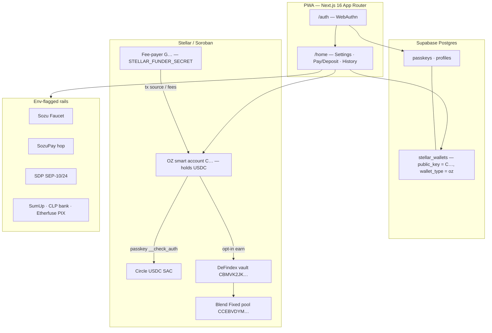

# Sozu Wallet

Self-custodial **Stellar USDC wallet**. Passkey signs a Soroban smart account. You pay, deposit, and optionally supply USDC into Blend through DeFindex.

Closed beta: [app.sozu.capital](https://app.sozu.capital) · Staging: [dev.sozu.capital](https://dev.sozu.capital)

This is the wallet. Credit, vouching, education, and “10–20% APY” are not the product.

---

## What it does

After a passkey signup the app provisions an **OpenZeppelin smart account** (`C…`). Home is three swipe panels: **Settings**, **balance + Pay/Deposit**, **history**.

| Action | What actually happens |
|--------|------------------------|
| **Pay** | Soroban USDC transfer from the `C…` account. Recipient is a Sozu tag, `C…`/`G…` address, or a SozuPay QR. The passkey authorizes the spend; a server **fee-payer `G…`** (`STELLAR_FUNDER_SECRET`) pays Soroban fees. |
| **Deposit** | Receive QR for the `C…` address, testnet faucet (when configured), CLP bank/card (when deposit flags are on), BRL/PIX via Etherfuse (when ramp flags are on). |
| **Earn** | User-initiated deposit into a **DeFindex vault** that supplies **Blend USDC**. Not automatic on inbound funds. Not a Sozu yield. |

Empty `$0` after setup is valid. Funding is Deposit.

---

## Yield (no advertised APY)

There is **no 10–20% APY**. Sozu does not set a rate.

When Blend/RPC is reachable, the UI shows the live **Blend USDC supply APY** (`estSupplyApy`) for the vault’s pool. That number moves with the pool. It is not guaranteed, not compounded as a Sozu product, and not a reason to deposit.

| Fact | Detail |
|------|--------|
| Source | `@blend-capital/blend-sdk` `PoolV2` reserve → `GET /api/wallet/defindex/apy` |
| Fallback | If Blend and DeFindex both fail, the API still returns **15.5%** with `source: fallback`. That is a placeholder, not a rate. Treat anything without `source: blend-sdk` as unknown. |
| How you earn | Tap earn in the balance breakdown → passkey-sign a vault deposit. Min ~10 USDC (`VAULT_MIN_DEPOSIT`). |
| Testnet catch | The public Paltalabs vault accepts **Blend pool USDC** (`CAQCFVLO…`), not Circle SAC (`CBIELTK6…`). Faucet/SozuPay USDC will not deposit until you hold Blend USDC. |
| Auto-deposit | `scripts/auto-deposit-cron.ts` exists. Inbound USDC does **not** auto-enter the vault in the demo path. |

Default strategy is Blend **Fixed** via DeFindex. YieldBlox is opt-in and higher risk. See [docs/wallet-stellar-defindex.md](./docs/wallet-stellar-defindex.md).

---

## Working integrations

Status is **what the code path does today**, not a roadmap.

| Integration | Role | When it actually runs |
|-------------|------|------------------------|
| **WebAuthn / passkeys** | Sign-in. Credentials live in Supabase `passkeys`. | Always. RP ID must match the host (`app.sozu.capital` / `dev.sozu.capital` / `localhost`). |
| **OpenZeppelin + `smart-account-kit`** | New-user `C…` wallet. Passkey is the on-chain signer. | Default path ([ADR 0001](./docs/adr/0001-auth-owned-oz-wallet-provisioning.md)). |
| **Supabase** | Postgres + RLS: profiles, passkeys, `stellar_wallets`, ledger, deposits. | Always. |
| **Stellar RPC + Horizon** | Balances, Soroban simulate/send, classic reads. | Always. Testnet unless `NEXT_PUBLIC_STELLAR_NETWORK=mainnet`. |
| **Circle USDC SAC** | Default receive / send token. | Default. Testnet `CBIELTK6…`. |
| **Blend** | Live supply APY + USDC reserve used by the vault. | Earn + APY badge. Testnet pool `CCEBVDYM…`. |
| **DeFindex** | Vault contract wrapping the Blend strategy. Deposit / withdraw. | Earn. Testnet vault `CBMVK2JK…`. |
| **Sozu Faucet** (`faucet.sozu.capital`) | Testnet USDC claim from Deposit. | `SOZU_FAUCET_URL` + `FAUCET_AUTH_SECRET`. Testnet only. |
| **SozuPay** (`pay.sozu.capital`) | Pizza hop / QR checkout. Wallet never runs WebAuthn on the Pay origin. | `NEXT_PUBLIC_SOZUPAY_URL`. |
| **SDP (SEP-10 + SEP-24)** | NGO disbursement recipient: invite → register → verify. | `SDP_ALLOWED_DOMAINS` and related SDP env. Entry: `/sdp/invite`. |
| **SumUp** | CLP **card** deposits (hosted checkout). | `DEPOSITS_ENABLED` + `NEXT_PUBLIC_DEPOSITS_ENABLED` + `SUMUP_API_KEY`. |
| **CLP bank transfer** | Wire instructions + **manual admin review**. | Same deposit flags + `SOZU_CLP_BANK_*`. |
| **Etherfuse** | BRL/PIX on/off-ramp. | `RAMP_ENABLED` + `NEXT_PUBLIC_RAMP_ENABLED` + `ETHERFUSE_*`. |
| **Gmail** | Optional email-ledger ingest from Settings. | `GOOGLE_OAUTH_CLIENT_ID` + secret. |
| **CLP FX** | Deposit quotes. mindicador.cl, optional Frankfurter, then `DEPOSIT_FX_CLP_PER_USDC`. | Deposit rail. |

**Not the new-user path:** Turnkey HD wallets. `lib/turnkey/` still names some Stellar helpers and leftover signing; signup provisions OZ, not Turnkey.

**Not integrated:** Stellar AMM, on-chain credit pools, KYC-free microloans, an education product that unlocks credit.

---

## Architecture



**Custody:** the passkey authorizes spends. The server never holds the user’s spend key. The fee-payer `G…` only sponsors gas.

**Tokens are contract IDs, not tickers.** Several assets are labeled USDC. Sends pick a `contractId`; see [docs/architecture/universal-token-rail.md](./docs/architecture/universal-token-rail.md).

**Schema:** `supabase/migrations/` is incremental. A new database is not recreatable from those files alone — dump an existing project or recover historical SQL.

---

## Stack

| Layer | What we actually use |
|-------|----------------------|
| App | Next.js 16 App Router, React 19, Tailwind 4, PWA (`public/manifest.json`). Installable. Not offline-first. |
| Auth | `@simplewebauthn/browser` + custom `/api/auth/*`. Supabase session after verify. |
| Wallet | `smart-account-kit`, `@stellar/stellar-sdk` 14, Soroban RPC. |
| Yield | `@blend-capital/blend-sdk`, `@defindex/sdk`. |
| Data | `@supabase/ssr` + service role on trusted routes. |
| Package manager | **pnpm**, Node 22+. |

API routes are Node route handlers, not a dedicated Edge backend.

---

## In the repo, not the live wallet

These routes and docs still exist. They are leftover or partner work, not the `/home` demo.

| Surface | Reality |
|---------|---------|
| `/dashboard/course` | Five static lesson cards. Completing them does not unlock credit. |
| `/credit` | Application UI. Only `mujeres2000` is `available: true` (CLP 2,000,000 / 180 days). No on-chain disbursement in this app. |
| `/dashboard/trust-points`, vouches | Tables + APIs exist. Not the first-run UX. |
| `/ledger`, `/tracker` | Gmail-derived expense ledger. Optional, Settings-gated. |
| [docs/credit-marketplace-roadmap.md](./docs/credit-marketplace-roadmap.md) | MUJERES 2000 / SozuPay vision. Operator flows live in [SozuPay_dashboard](https://github.com/blessedux/SozuPay_dashboard). |
| [docs/privacy-wallet-roadmap.md](./docs/privacy-wallet-roadmap.md) | Phases 1–10 privacy/compliance plan. Not shipped. |
| Turnkey `createStellarWallet` | Legacy G-wallet factory. New users do not go through it. |

---

## Quick start

```bash
git clone https://github.com/Sozu-Capital/sozu-wallet.git
cd sozu-wallet
pnpm install
cp .env.example .env.local
# Fill Supabase, RP ID, Soroban RPC, STELLAR_FUNDER_SECRET (funded G on the target network),
# and OZ contract IDs. See .env.example — it is the full list.
pnpm dev
```

Open `http://localhost:3000` → `/auth` → passkey → `/home`.

Deploy: one GitHub repo, one Vercel project (`sozu-wallet`). `dev` → Staging, `main` → Production. [docs/deployment.md](./docs/deployment.md), [docs/vercel-consolidation.md](./docs/vercel-consolidation.md).

Passkeys are origin-bound. `NEXT_PUBLIC_APP_URL` and `NEXT_PUBLIC_RP_ID` must match the hostname you actually use.

---

## Docs

Index: **[docs/README.md](./docs/README.md)**

| Topic | Doc |
|--------|-----|
| OZ wallet provisioning | [docs/adr/0001-auth-owned-oz-wallet-provisioning.md](./docs/adr/0001-auth-owned-oz-wallet-provisioning.md) |
| C-address sends | [docs/smart-account-default-payments.md](./docs/smart-account-default-payments.md) |
| DeFindex / Blend / APY | [docs/wallet-stellar-defindex.md](./docs/wallet-stellar-defindex.md) |
| Fiat deposits | [docs/payments-and-settlement.md](./docs/payments-and-settlement.md) |
| Gmail ledger | [docs/email-ledger-and-gmail.md](./docs/email-ledger-and-gmail.md) |
| Auth recovery | [docs/authentication-and-accounts.md](./docs/authentication-and-accounts.md) |
| Git flow | [docs/agents/git-flow.md](./docs/agents/git-flow.md) |
