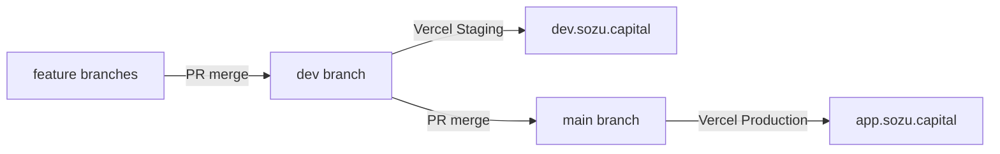

# Git flow for Sozu Wallet

Agent and developer reference for the Sozu Wallet promotion chain.

**Feature PRs target `dev`. Never `main`.** Staging is where we test. Production is a later promotion PR.

## Branch model

```yaml
featureBase: dev
deployTrigger: main
promotion: feature → dev → main
vercelProject: sozu-wallet
githubRepo: Sozu-Capital/sozu-wallet
```



| Environment | Git branch | Domain | Vercel target |
|-------------|------------|--------|---------------|
| Staging | `dev` | `dev.sozu.capital` | Custom **Staging** on `sozu-wallet` |
| Production | `main` | `app.sozu.capital` | **Production** on `sozu-wallet` (closed beta) |
| PR previews | feature PRs | `*.vercel.app` | Preview |

## Day-to-day workflow

1. **Feature work:** Branch from `dev`, open the PR against `dev` → Staging at `dev.sozu.capital`
2. **Test on Staging** (`dev.sozu.capital`) before any production promotion
3. **Release:** PR `dev` → `main` → Production at `app.sozu.capital`
4. **Closed-beta / deposit tests:** Use Staging — never a second Vercel project
5. **Protect branches:** Required PR reviews on `main` (and ideally `dev`)

### PR base rules

| Kind of PR | Base | Notes |
|---|---|---|
| Feature, fix, ticket, hackathon slice | `dev` | Default. Agents must set this in `gh pr create --base dev`. |
| Stacked ticket (child of an open sibling) | The parent ticket's **head branch** | Example: ticket 2 bases on ticket 1's branch while PR 42 is open. After the parent merges to `dev`, retarget the child to `dev`. |
| Production release | `main` | Only a `dev` → `main` promotion PR. |

Do **not** open a feature PR against `main`. That skips Staging and ships passkey-bound work to `app.sozu.capital`.

Hack Meridian wallet tickets follow the same chain: #1 and #2 land on `dev` first. Ticket #2 stays stacked on #1's head until #1 merges to `dev`.

## Agent instructions

When implementing tickets with `/ship-ticket` or similar:

- **Cut the branch from `origin/dev`**, not from `main`
- **Open the PR against `dev`** (`gh pr create --base dev`)
- **Deposit / P2P / offline-vault testing** on Staging before promoting to Production
- **Production releases** require a separate PR from `dev` → `main`
- **Do not** create another Vercel project for feature flags
- If a ticket is stacked, keep the child's base on the parent's head until that parent is in `dev` — then retarget the child to `dev`, still not to `main`

## Why separate Staging and Production?

**Passkey binding:** WebAuthn credentials are origin-bound. A passkey on `dev.sozu.capital` cannot unlock `app.sozu.capital`.

- Staging: `NEXT_PUBLIC_RP_ID=dev.sozu.capital`
- Production: `NEXT_PUBLIC_RP_ID=app.sozu.capital`

## Closed beta

Closed beta = Production env flags (`NEXT_PUBLIC_BETA_TIER=closed`, deposits on), not a fork or second project. See [vercel-consolidation.md](../vercel-consolidation.md).

## Historical note

Previously: two Vercel projects (`sozu-credit` / `credit.sozu.capital` and `sozu-cosed-beta` / `app.sozu.capital`). That split is deprecated — consolidate per the cutover guide.
